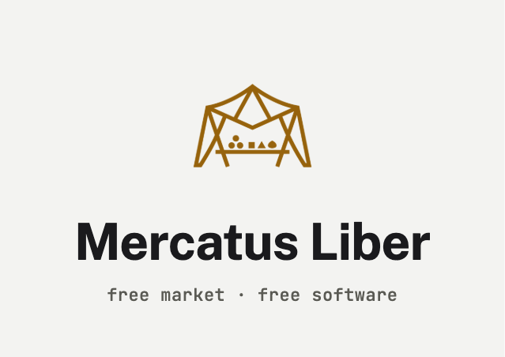

[](https://github.com/mdostal/mercatus-liber/actions/workflows/ci.yml)
[](LICENSE)

# Mercatus Liber

**A free, MIT-licensed, headless commerce framework: an open alternative to Shopify that you
own and can run anywhere.**

No per-transaction cut, no app-store tax, no required vendor. Every subsystem is its own
package behind a narrow interface, so you can swap the database, CMS, payments, auth, or
fulfillment provider without touching the rest. Everything a person can do in the admin, an AI
agent can do through the same interfaces over MCP.

[Live demo](https://commerce.mdostal.com) · [Docs](https://mercatus-liber-docs.vercel.app) ·
[Wiki](https://github.com/mdostal/mercatus-liber/wiki) · [Vision and roadmap](VISION.md) ·
[Contributing](CONTRIBUTING.md)

> **Status: pre-1.0, not yet on npm.** The packages run in production on the demo stores below,
> but you consume them from this monorepo for now. npm publishing is planned after a dogfooding
> period on a real store. Expect breaking changes between versions; see
> [CHANGELOG.md](CHANGELOG.md).

## See it running

Three sample stores, all built from the same open-source app
([`apps/reference-storefront`](apps/reference-storefront)). They are meant to be read and
copied: each one is a public example of building a storefront on the framework.

| Store | What it is | Theme | Backend | Links |
|---|---|---|---|---|
| The Print Shop | Embroidery and custom prints | `editorial` | Postgres | [standalone](https://mercatus-liber-print-shop.vercel.app) · [shared](https://commerce.mdostal.com/demo/print-shop) |
| Northline Home Tech | Smart-home installer with service-area pages | `northline` | Postgres | [standalone](https://mercatus-liber-northline.vercel.app) · [shared](https://commerce.mdostal.com/demo/northline) |
| Broadleaf & Co. | Artisan and handmade goods | `vibrant` | Convex | [standalone](https://mercatus-liber-broadleaf.vercel.app) · [shared](https://commerce.mdostal.com/demo/broadleaf) |

The demos run in sandbox payment mode, so no real charges happen. Details:
[sample stores](apps/docs/content-src/sample-stores.md).

## Quick start

Requires Node 22.13 or newer and pnpm 11 (`corepack enable` picks up the pinned version).

```bash
git clone https://github.com/mdostal/mercatus-liber.git
cd mercatus-liber
pnpm install
pnpm turbo run build --filter=@mercatus-liber/reference-storefront^...
pnpm --filter @mercatus-liber/reference-storefront dev
```

Then open <http://localhost:3000/demo/print-shop>. No accounts or environment variables are
needed: with nothing configured, the app runs on in-memory SQLite and reseeds on restart.
Set `DATABASE_URL` or `SQLITE_FILE_PATH` to persist the catalog. Every variable is listed in
the [configuration reference](apps/docs/content-src/configuration.md).

To start your own store, use the scaffolder:
[`packages/create-store`](packages/create-store/README.md).

## What's in the box

**Commerce core:** catalog with multi-axis variants, a marketing catalog kept separate from the
sales catalog, search, product pages, long-lived cart, checkout and orders, customer accounts,
inventory.

**Merchandising and content:** per-page CMS (no forced whole-site theme), 10 theme bundles,
promotions, bundles, recommendations, advertising, reviews, storefront views, service-area
pages, community goals, and made-to-order customization with an admin-defined pricing engine.

**Operations:** role-based admin auth, fulfillment, shipping, webhooks, accounting sync,
analytics, internal BI, a store scaffolder, auto-update, and a Shopify migration tool.

**Outside apps:** a key-authenticated store API and typed client, so apps such as flayr can import the catalog and run promotions ([`packages/store-api`](packages/store-api/README.md), [flayr plan](docs/integrations/flayr.md)).

**AI access:** MCP server and tool catalog calling the same subsystem interfaces as the admin
([`packages/ai-interface`](packages/ai-interface/README.md)).

## Adapters

An adapter implements a subsystem's interface for one provider. "Live" means running on the demo
stores. "Unverified" means built and unit-tested against the provider's documented API, but
never run against a real account.

| Area | Adapter | State |
|---|---|---|
| Database | `adapter-sqlite` | Local and zero-config default |
| Database | `adapter-postgres`, `adapter-postgres-inventory` | Live |
| Database | `adapter-convex` | Live |
| Database | `adapter-mongodb` | Built and tested, not live |
| Commerce backend | `adapter-shopify` | Unverified; available through `create-store`, not used by the demos |
| CMS | `adapter-sanity` | Live |
| Admin auth | `adapter-clerk` | Live |
| Payments | Stripe (in `payments`) | Live in sandbox mode |
| Payments | `adapter-paypal` | Unverified |
| Print on demand | `adapter-printful`, `adapter-printify` | Unverified; activates when credentials are set |
| 3D print on demand | `adapter-slant3d`, `adapter-3dapi` | Unverified; activates when credentials are set. See `docs/integrations/3d-print-on-demand.md` |
| Shipping | `adapter-shippo` | Unverified |
| Images | `adapter-cloudinary` | Unverified |
| Accounting | `adapter-quickbooks` | Unverified |
| Analytics | PostHog (in `analytics`) | Live |
| Analytics | GA4 (in `analytics`) | Unverified |

Database support is not uniform yet. Postgres covers nearly every commerce subsystem, while Convex,
MongoDB, and SQLite mainly cover the catalog and customization. The
[integrations catalog](apps/docs/content-src/integrations.md) has per-adapter detail and the
environment variables for each.

**Leaving Shopify:** [`migrate-shopify`](packages/migrate-shopify/README.md) reads a store once
and writes it into native persistence, with a dry-run default. It covers products, collections,
and inventory, but not orders, customers, or images yet. `adapter-shopify` is the other route: it
keeps Shopify as the backend.

## Build on it

**Write a plugin** for anything that should react to commerce events. A plugin gets the event bus
and nothing else:

```ts
import type { Plugin } from "@mercatus-liber/plugins";

export const orderLogger: Plugin = {
  name: "order-logger",
  init({ events }) {
    events.subscribe<{ orderId: string }>("checkout.order.placed", async ({ orderId }) => {
      console.log(`order placed: ${orderId}`);
    });
  },
};
```

**Write an adapter** to connect a new provider: implement the subsystem's interface in a new
`packages/adapter-*` package. See [the adapter pattern](CONTRIBUTING.md#the-adapter-pattern--how-most-contributions-are-shaped).

**Looking for something to build?** Wishlists, gift cards, subscriptions, returns, marketplace
sync, and more are listed in [VISION.md's community frontier](VISION.md#wanted-not-started--the-community-plugin-frontier).

## UI: how it's organized

| Layer | Where | State |
|---|---|---|
| Sample stores | `apps/reference-storefront` | Live, public, and meant to be copied |
| Theme tokens and bundles | `packages/theming` | Live, 10 bundles |
| Other storefront components | `apps/reference-storefront/components` | Live, but navigation, home, category, and CMS components are still inside the app |
| Common components | `packages/storefront-ui` | Partial: cart and product page templates, plus the customizer and price breakdown, live on The Print Shop's [dad cap](https://commerce.mdostal.com/demo/print-shop/products/embroidered-dad-cap) |
| Customizer Web Component | `packages/customization-ui` | Framework-free, but still on hex colors and not used by a sample store |
| Default UI | Not built | Planned: move the remaining app components into `storefront-ui` as a default storefront |

## What's being worked on

- **Customization:** a quote flow for request-only options; see its
  [known limitations](packages/customization/README.md#known-limitations).
- **UI:** moving the rest of the app's components into `storefront-ui` as a default UI.
- **Release:** npm publishing, after dogfooding on a real store.

## How it's built

```
packages/    52 packages: core types, one package per subsystem, one per adapter
apps/
  reference-storefront/   the sample stores (Next.js)
  docs/                   the docs site (Nextra)
docs/        architecture and one reference doc per subsystem
```

One rule holds it together: **no subsystem imports another subsystem's internals.** They share
core types, adapter interfaces, and a typed event bus. If replacing subsystem A means changing
code inside subsystem B, that's a bug. `apps/reference-storefront/lib/services.ts` is where
concrete adapters get chosen. Read more in [docs/ARCHITECTURE.md](docs/ARCHITECTURE.md).

## Documentation

- [Getting started](apps/docs/content-src/getting-started.md)
- [Architecture](docs/ARCHITECTURE.md)
- [Subsystem reference](docs/subsystems/) (28 docs)
- [Configuration reference](apps/docs/content-src/configuration.md)
- [Integrations catalog](apps/docs/content-src/integrations.md)
- Each package's own `README.md`

## Contributing

Issues and pull requests are welcome. Start with [CONTRIBUTING.md](CONTRIBUTING.md). Please report
security problems as described in [SECURITY.md](SECURITY.md).

## License

[MIT](LICENSE)
